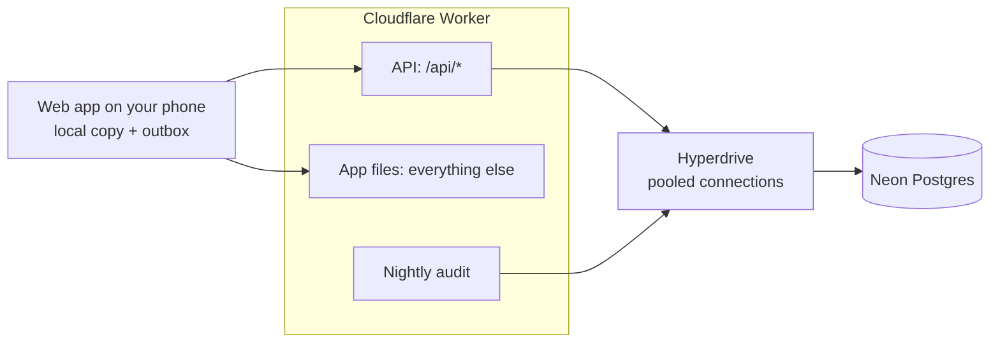

# Eventide — design

Status: 2026-10-25. Built and tested: the ledger core (§5) and the database with its write paths (§6, §7).
The API, the app and the load tests are still the plan.

---

## 1. What it is

Eventide splits shared costs between people: flatmates, a trip, a dinner. Someone pays, the app records who owes
what, and at the end it says who should pay whom so that everyone is even, in as few payments as possible.

Splitwise and others already do this. The point of Eventide is not a new idea but a careful build of an
ordinary one: money that is always exactly right, many people editing the same group at once, phones that go
offline, and every claim about reliability backed by a test or a measurement.

## 2. Goals and non-goals

**Goals**

1. **Money is never wrong.** No rounding drift, no lost pennies, no balance that cannot be explained line by line.
2. **Concurrent edits are safe.** Two people adding expenses to the same group at the same moment both land.
   Two people editing the *same* expense do not silently overwrite each other.
3. **Retries are safe.** A phone on a bad connection can resend any request and it takes effect once.
4. **Works offline.** Add an expense on a plane; it syncs when you land.
5. **Costs nothing to run.** Every service on a free tier (§11), and portable enough to leave any of them.
6. **Proven, not claimed.** Load, concurrency and crash tests with published numbers (§12).

**Non-goals (for now)**

- Moving real money. Eventide records that Sam paid Alex back; it does not move the money.
- Automatic currency conversion (§5.6).
- Bank or receipt import.
- Native apps. It is an installable web app (PWA).

## 3. Requirements

**Functional**

- Sign in with Google or GitHub.
- Create a group, invite people by link, add members who have no account yet (they can claim their place later).
- Add an expense: amount, currency, who paid (one or several people), how it is split (equally, exact amounts,
  percentages, or shares).
- Edit or delete an expense; see its history.
- Record a payment between two members.
- See balances, and a suggested set of payments to settle up.

**Non-functional**

| | Target | How it will be checked |
|---|---|---|
| Correctness | Every group's balances add up to zero in every currency, always | Property tests (§5), a database constraint (§5.3), and a nightly audit query (§13) |
| Duplicate writes | 0 under retries and crashes | Crash test: kill the API mid-write, retry with the same key (§12) |
| Lost updates | 0 under concurrent edits | Concurrency test: many clients, one group (§12) |
| API latency | p95 under 300 ms for reads and writes from Europe | k6 against a local stack; spot checks against production |
| Settle-up CPU | under 10 ms (the Worker free-plan limit) | Benchmark (§5.5) |

## 4. Architecture



- **`@eventide/ledger`** (`packages/ledger`) — the money rules: splitting, postings, balances, settle-up. Pure
  functions with no I/O, used by both the API and the app, so a preview on the phone and the stored result
  are computed by the same code.
- **One Worker, one origin.** The same Cloudflare Worker serves the API under `/api/*` and the app's files for
  every other path. Same origin means the session cookie is first-party (no cross-site cookies, which Safari
  blocks) and there is no CORS to get wrong. The Worker is stateless: it authenticates the request, runs the
  ledger rules, and writes in one database transaction. Its scheduled handler runs the nightly audit (§13).
- **Hyperdrive** — Cloudflare's pool of warm connections to Neon. It lets the Worker use node-postgres, the same
  driver the tests use, so the code that is tested is the code that runs. The Worker is placed in the database's
  region: a write is about a dozen round trips to Postgres and one to the visitor, so the short side should be
  the database one.
- **Postgres** — the single source of truth. It enforces the money rules a second time (§5.3), so a bug in the
  API cannot write an unbalanced ledger.
- **Web app** — keeps a local copy of each group and an outbox of changes not yet sent (§8).

Why these pieces: [ADR 0001](decisions/0001-postgres-as-source-of-truth.md),
[ADR 0004](decisions/0004-free-tier-hosting.md) and [ADR 0005](decisions/0005-one-worker-and-hyperdrive.md).

## 5. The ledger

### 5.1 Money

Amounts are whole numbers of the currency's smallest unit: £12.30 is `1230`, ¥1500 is `1500`, 1.234 KWD is
`1234`. Text is parsed digit by digit, never through a float (`"0.29"` is 29, not 28.999…). More decimals than
the currency has is an error, not a rounding. Amounts must be safe integers (below 2^53).
[ADR 0002](decisions/0002-integer-minor-units.md).

### 5.2 Splits

An expense keeps the split *as the person entered it* (`equal`, `exact`, `percent` in basis points, `shares`),
and the amounts are derived from it. That way an edit shows "split equally between 3", not three numbers.

Every split goes through one allocation function (`allocate.ts`), the largest remainder method: everyone gets
the floor of their exact share, and the units left over go one each to the largest remainders. The parts always
add up to the total, and each is within one unit of its exact share. Members are sorted first, so the order the
app sent them in never decides who pays the odd penny.

Known trade-off: the odd penny goes to the same person (by id) on equal splits. Over hundreds of expenses that is
pennies; rotating it would make a split depend on history, which is worse.

### 5.3 Double-entry postings

Each transaction (expense or payment) becomes **postings**: one per member, what they paid minus what they owe.

```
Alex pays £90 dinner, split equally between Alex, Priya, Sam
  alex   +60.00
  priya  -30.00
  sam    -30.00
         ------
           0.00
```

Postings for one transaction always add up to zero per currency. Money only moves between members, so a
group's balances (the sum of each member's postings) always add up to zero too. That is the invariant everything
else protects.

It is checked twice: in TypeScript before writing (`assertBalanced`), and in Postgres by a deferred constraint
trigger that rejects the commit if any transaction's postings do not sum to zero (§6). Postings can be inserted
but never updated or deleted; the database role the API uses does not have those permissions.

### 5.4 Edits and deletes never rewrite history

Editing an expense appends the reverse of its old postings and then its new ones; deleting appends only the
reverse. Nothing is updated in place, so any balance can be explained line by line and "who changed this, and
from what" is always answerable. [ADR 0003](decisions/0003-append-only-ledger.md).

### 5.5 Settling up

Given a group's balances in one currency, find payments that bring everyone to zero, as few as possible.

- Any n people with non-zero balances can settle in n − 1 payments (pay the largest debt to the largest credit,
  repeat; each payment clears at least one person).
- It can do better when the group splits into subgroups whose balances already cancel: a subgroup of k needs only
  k − 1. So the minimum is **n minus the largest number of zero-sum subgroups**.
- Finding that is NP-hard in general (it contains subset-sum), so `settleUp` searches it exactly with dynamic
  programming over subsets (2^n × n steps) for up to 15 people with non-zero balances, and uses the greedy method
  above that.

Example where it matters: balances −10, −9, +4, +9, +6. Greedy takes 4 payments; the exact search sees that
−9 and +9 cancel and takes 3.

The limit of 15 is measured, not guessed (`scripts/bench-settle.ts`, Node 22, cloud Xeon 2.8 GHz,
2026-10-25):

| People with a balance | median | p95 |
|---|---|---|
| 12 | 0.32 ms | 0.39 ms |
| 14 | 1.38 ms | 1.55 ms |
| **15** | **2.80 ms** | **3.09 ms** |
| 16 | 5.51 ms | 6.96 ms |
| 18 | 23.89 ms | 33.17 ms |

15 leaves about 3× headroom under the Worker's 10 ms CPU limit; 16 does not. To re-check on Workers itself once
the API exists.

Tests check, over thousands of random inputs: every suggestion clears every balance, uses at most n − 1 positive
payments, is never worse than greedy, and matches a brute-force search over every partition for small groups.

**Trade-off to surface in the app:** minimal payments can ask Sam to pay Priya even though Sam only ever owed
Alex. That is correct, but can surprise people, so the app will explain it.

### 5.6 Currencies

Balances are kept per currency and never mixed. Converting needs an exchange rate and a moment to take it from;
the app may offer "settle this in GBP at today's rate" later, recorded as an explicit conversion transaction
with the rate stored, never as a silent recalculation.

## 6. Data model

The schema is [`0001_ledger.sql`](../packages/db/migrations/0001_ledger.sql); roles and commands are in
[DATABASE.md](DATABASE.md).

```sql
users                 (id, email unique, name, created_at)
groups                (id, name, default_currency, seq, created_by, created_at)
members               (id, group_id, display_name, user_id null, role, joined_at, left_at)  -- user_id null: no account yet
transactions          (id, group_id, kind, revision, deleted, description, occurred_on, currency, body jsonb, ...)
entries               (id, group_id, seq, kind create|edit|delete, transaction_id, revision, created_by, created_at)
transaction_revisions (transaction_id, revision, entry_id, deleted, description, occurred_on, currency, body)
postings              (id, entry_id, group_id, member_id, currency, amount bigint)
idempotency_keys      (user_id, key, request_hash, response jsonb, created_at)
```

- **`members` is separate from `users`** so you can split with someone before they sign up.
- **`postings` is the ledger.** `transactions` is the current version of each expense or payment, for reading;
  `transaction_revisions` keeps every version; `entries` is one row per change, numbered by the group's `seq`.
  All of them are written in the same database transaction.
- **`entries`, `transaction_revisions` and `postings` are append-only**, enforced by triggers that stop even the
  owner, and by the API's role having no `UPDATE` or `DELETE` on them.
- **Postings reference `(group_id, member_id)` and `(group_id, entry_id)`**, so a posting can never point into
  another group.
- **Balances** are `select member_id, currency, sum(amount) from postings where group_id = $1 group by …`, read
  from a covering index `(group_id, currency, member_id) include (amount)`. If the load test says that is too slow,
  a `balances` table updated in the same transaction is the next step, not before.
- **Edits reverse what was written.** An edit's reversal is read from the postings actually stored for that
  transaction, not recomputed from its body, so a future change to the splitting rules can never make a
  reversal undo the wrong amount. There is a test that tampers with the body to prove it.
- **Leaving, removing, deleting** (migration 0003). Someone can leave, or be removed, only at a zero balance in
  every currency, checked under the group's row lock, so a debt can never leave with a person. A group can be
  deleted by the person who started it; that hides it from everyone (`groups.deleted_at`, enforced by row-level
  security) while its ledger stays, append-only like everything else.
- **`sessions` and `invites`** (migration 0002) store only SHA-256 hashes of their tokens. Joining by invite and
  claiming a place made by name ("I'm Sam") run as security-definer functions, because the person joining
  cannot yet see the group.

## 7. Writes: consistency and concurrency

Every write is one Postgres transaction:

1. **Idempotency.** The client sends an `Idempotency-Key` (a UUID made when the user pressed Save). The first
   statement inserts it; if it already exists with the same request hash, the stored response is returned and
   nothing else runs. Same key, different body: rejected. A retried request therefore takes effect once, even
   if the first attempt's response was lost.
2. **Ordering.** `update groups set seq = seq + 1 where id = $1 returning seq` gives the entry a per-group sequence
   number. This row lock also serialises writes *within one group*, which is what makes the change feed (§8)
   gap-free. Different groups never wait on each other. One group sees a few writes a minute, so the lock costs
   nothing in practice. The concurrency test (§12) measures it.
3. **Edits are optimistic.** The client sends the revision it edited. `update expenses set revision = revision + 1
   where id = $1 and revision = $2`; zero rows updated means someone else got there first, and the API returns
   409 with the current version so the app can show both.
4. **Postings are inserted**, and the deferred trigger checks they balance at commit.

Adding expenses never conflicts: postings only add up, and addition does not care about order.

Each claim in this section has a test against real Postgres with real concurrent connections
([`concurrency.db.test.ts`](../packages/db/tests/concurrency.db.test.ts)): 50 simultaneous writes to one group all
land, numbered 1 to 50 with no gaps; one request sent 20 times at once is applied once; of 10 simultaneous edits
of the same version, exactly one wins and nine get CONFLICT. The ordering guarantee is tested deterministically,
not by hoping for an unlucky interleaving: one write is held just before its commit while a second is started,
and the second must not become visible first. Replacing the row lock with a plain Postgres sequence makes that
test fail, which is how we know it tests the right thing.

Why the per-group sequence and not a global `bigserial`: sequence values are handed out at insert time but
become visible at commit time, so a reader can see 12 and 14 before 13 commits, store "seen up to 14", and miss
13 forever. A counter bumped under a row lock commits in order.

## 8. Offline and sync

- The app keeps each group in IndexedDB and shows it instantly, online or not.
- Changes go into an **outbox**, each with its idempotency key, and are sent in order when there is a connection.
  Sending twice is harmless (§7).
- The app pulls `GET /groups/:id/changes?after=<seq>` and applies entries in order. `seq` is gap-free per group,
  so "after" never skips anything.
- Offline adds always merge cleanly. Offline edits to an expense someone else also edited come back as a 409
  conflict, shown to the person to resolve: two versions of a money record should not be merged by a rule.
- Updates arrive by polling on focus and every 30 seconds while open. Live push (WebSockets through Durable
  Objects) is possible later but not needed to be correct.

## 9. Security and privacy

- **Sign-in:** OAuth 2 with GitHub or Google, authorisation code flow with PKCE, and a `state` checked against a
  short-lived cookie so a sign-in response only completes in the browser that started it (no login CSRF). Only a
  verified email is accepted. No passwords are stored. After sign-in, the redirect only ever goes to a path on
  this site.
- **Sessions:** 32 random bytes in a `__Host-` cookie (`Secure`, `HttpOnly`, `SameSite=Lax`, path `/`, no
  domain), stored as a SHA-256 hash, 30 days, deleted on sign-out.
- **Cross-site requests:** every request that changes data must carry this site's own `Origin`; anything else
  gets 403. Browsers set `Origin` themselves and a page elsewhere cannot fake it.
- **Authorisation:** every query that touches a group goes through one function that first checks membership.
  As a second layer, Postgres row-level security restricts rows to groups the current user belongs to (the
  API sets the user id per transaction), so a missed check in the API still cannot read another group.
- **Invites:** 128-bit random tokens, stored hashed, expiring, revocable.
- **Input:** every request body is validated against a strict schema (unknown fields rejected, sizes capped,
  64 KB body limit) before it reaches the ledger. Errors have one shape, `{ error: { code, message, details } }`,
  and a 500 never includes internals; the log has them, under the request id.
- **Data kept:** name, email, and what you enter. No analytics trackers.

### 9.1 Signing in to the Windows app

The Windows app (desktop/, Tauri) is the live site in a WebView2 window. Google refuses sign-in inside an app's own
web view, and the browser's session cookie cannot be handed to the app, so:

1. When the window starts to open `/api/auth/<provider>`, the app cancels it, makes a 32-byte secret (the
   verifier) that it keeps in memory, and opens the same address in the browser with `handoff=` the verifier's
   base64url SHA-256 (the challenge). The challenge rides in the OAuth `state` cookie.
2. After the provider answers, the server signs no one in in the browser. It stores a one-time code (hashed,
   two minutes, migration 0005) with the user and the challenge, and sends the browser to
   `/desktop-return#code=…`, which opens `eventide://signin?code=…`. The code is in the fragment, which never
   reaches a server or its logs.
3. The app loads `/desktop#code=…&verifier=…` in its window, which posts both to `/api/auth/handoff`. The code is
   deleted as it is read; only if the verifier hashes to the stored challenge does the window get a session
   cookie of its own.

Another program that registers `eventide://` and catches the code cannot use it: it lacks the verifier, and its
attempt uses the code up. `/api/auth/handoff` only answers a user agent containing `EventideDesktop/`, so a link
carrying someone's code and verifier cannot sign an ordinary browser in to their account. This is the same idea
as PKCE (RFC 7636), applied to the step after the provider.

The Android app needs none of this: it is a Trusted Web Activity, the site running in the phone's Chrome, so it
shares Chrome's sign-in and cookies (docs/APPS.md).

## 10. Capacity and scaling

Eventide will not have a million users; the point is to know where it would break. Back of the envelope for
1 million registered users:

| | Estimate |
|---|---|
| Daily active (20%) | 200,000 |
| Writes | 2 per active user per day → 400,000/day → ~5/s average, ~50/s at a 10× peak |
| Reads | 20 per active user per day → 4 million/day → ~46/s average, ~500/s at peak |
| Storage | ~0.6 KB per expense with its postings and indexes → ~90 GB/year |

One Postgres instance handles that write rate easily; reads are cheap indexed sums. In order, the scaling steps
would be: a `balances` table if summing gets slow; read replicas for reads; and, much later, partitioning by
`group_id`. Groups are independent, so they partition cleanly. Each step waits for a measurement that says it is
needed.

## 11. Running it for free

| Service | Free allowance (checked 2026-10-25) | Eventide's use |
|---|---|---|
| Cloudflare Workers | 100,000 requests/day, 10 ms CPU per request, no card | API and app files; roughly 5,000 sessions a day |
| Cloudflare Hyperdrive | 100,000 queries/day | A write is about 8 queries (transaction, idempotency, membership, one statement for the lock and inserts), a read about 6: roughly 12,000 writes or 16,000 reads a day. The tighter of the two free limits, and the first thing to optimise (one SQL function per write) if it ever matters |
| Neon Postgres | 0.5 GB storage (1 GB per recent reports), 100 compute-hours/month, sleeps after 5 idle minutes | The database: roughly 800,000 expenses |
| GitHub Actions | Free for public repositories | CI, with Postgres as a service container |

Limits to know about:

- When Neon hits a monthly limit it suspends the database until the next month. Load tests therefore run against
  a local Postgres, never production.
- The first request after five idle minutes waits for Neon to wake (well under a second).
- Free tiers change. The code uses standard Postgres and plain HTTP so moving provider is a configuration
  change. [ADR 0004](decisions/0004-free-tier-hosting.md).

## 12. Testing, and proving the claims

| Layer | What | Status |
|---|---|---|
| Ledger | Unit tests and property tests (fast-check): splits add up, postings balance, settle-up clears everything and matches brute force | Done |
| Database | Integration tests against real Postgres 16: the zero-sum trigger, append-only triggers, row-level security, migrations, idempotency, optimistic edits, the change feed | Done (37 tests) |
| API | Real HTTP requests through every middleware against Postgres: sign-in (with stand-ins for GitHub and Google), cookies, cross-site refusal, validation, idempotency byte for byte, 409 on stale edits, outsiders get 404 | Done (20 tests) |
| Workers runtime | `wrangler dev` (the real Workers runtime) against local Postgres through the Hyperdrive setting, driven by `scripts/smoke.ts` | Done locally; against production at deploy |
| Concurrency | 50 simultaneous writes to one group; 20 copies of one request; 10 simultaneous edits; ordering under a held commit; leaving while an expense naming you is saved | Done |
| Crashes | Kill the API process mid-write repeatedly, retry with the same keys; count duplicates and losses | Done: 800 of 800, 0 lost, 0 duplicated, 15 kills ([PERFORMANCE.md](PERFORMANCE.md)); a smaller run in CI |
| Load | Rising concurrency against the API on Node and Postgres: requests/s, p50/p95/p99, server CPU per request | Done ([PERFORMANCE.md](PERFORMANCE.md)) |
| App | Playwright: add, edit, settle, and the offline outbox | Phase 3 |

## 13. Operations

- Structured JSON logs with a request id on every line.
- Latency and error rate per route.
- **Nightly ledger audit** (Workers cron): `select group_id, currency from postings group by 1, 2 having sum(amount)
  <> 0` must return nothing. If it ever does, that is a bug worth waking up for.

## 14. Plan

| Phase | What | Done when |
|---|---|---|
| 0 | Design, ledger core | Done |
| 1 | Database schema, migrations, write paths, integration tests | Done |
| 2 | API: auth, groups, members, invites, expenses, payments, settle-up, change feed | Built and tested; deploying is the last step (docs/DEPLOY.md) |
| 3 | Web app: installable, offline outbox | Built and tested end to end; on your phone for feedback |
| 4 | Concurrency, crash and load tests | Done: [PERFORMANCE.md](PERFORMANCE.md) |
| 5 | Case study card on the portfolio | Live |

## 15. Open questions

- ~~Frontend framework~~: Preact with signals, about 20 KB gzipped in all. Forms and lists are most of the app,
  and a component model pays for itself there; React's runtime would be five times the size for no gain.
- ~~Rate limiting~~: Cloudflare's rate limiting binding, 300 requests a minute per IP and 120 per person, plus
  invite-only sign-up (docs/DEPLOY.md, "Protecting the free allowances").
- Leaving a group and removing a member (allowed only at a zero balance).
- Placeholder members claiming their place: by invite link only, or also by matching email.
